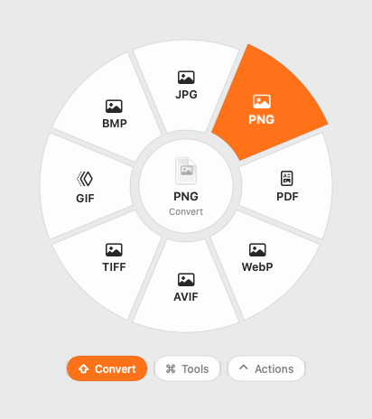

# Cutie



A file converter for the Mac that lives in the menu bar. Drag a file, tap a
key while you're still holding it, and drop it on a wheel of choices. The
result appears where you dropped it, saved next to the original. Everything
runs on your Mac: Cutie has no network code at all.

## Download

[**Download Cutie**](https://github.com/yesokcool/cutie/releases/latest/download/Cutie.zip)
(the newest version, from [Releases](https://github.com/yesokcool/cutie/releases)),
open the zip and drag Cutie to Applications. It's signed and notarized by Apple, so
it opens like any other app. Needs macOS 26 or later.

## How it works

While dragging one or more files (from Finder, the Desktop or any app that
drags real files), tap a key:

| Key | Wheel | What's on it |
|---|---|---|
| ⇧ Shift | **Convert** | The formats this file can become |
| ⌘ Command | **Tools** | Compress, resize, rotate, trim, split, merge… |
| ⌃ Control | **Actions** | AirDrop, Float, Copy, Move, Copy Path, Terminal |

Drop on a slice to run it. Any spot past the center hole counts, in the
slice's direction; the center cancels. Tap another key to switch wheels, or
the same key to close. The keys can be changed in Settings.

- **Results** show up as a small pill where you dropped. Drag the pill on to
  wherever the file goes next, or click it to show the file in Finder.
- **Originals are never changed.** Each job works in a temporary folder, and
  the result is placed beside the original under a new name ("photo 2.png").
- **Without a drag:** select files in Finder and press ⌃⌥C, or pick
  Convert Files… from the menu bar icon. Then choose with the arrow keys and
  Return.
- **Float** keeps files in a small shelf above your windows, to drag out later.

## What it converts

The aim is output a professional would trust: nothing about a file changes
unless that's what you asked for, and a damaged or half-downloaded file is
refused rather than "converted".

- **Images:** JPG, PNG, HEIC, AVIF, TIFF, GIF, BMP, PDF; also reads SVG,
  WebP and camera RAW. WebP output needs `cwebp`. Colour profiles (Display
  P3, CMYK where the format allows), 16-bit depth, DPI, camera metadata
  (EXIF, GPS, XMP) and animation carry over; an HDR photo keeps its gain map
  in JPG, HEIC and AVIF and is tone-mapped for the rest.
- **Video and audio:** MP4, MOV, GIF, M4A, WAV, AIFF, FLAC. With ffmpeg:
  MP3, OGG, Opus, WMA, MKV, WebM, AVI, WMV. Every audio track, subtitle,
  chapter, cover and tag is kept; streams that already fit the new format are
  copied, not re-encoded; HDR stays HDR (10-bit HEVC) and is tone-mapped for
  GIF, AVI and WMV; hi-res audio keeps its bit depth and sample rate; an
  iPhone video keeps its date and location.
- **PDF** to Word (rebuilt: headings, paragraphs, lists, tables, pictures and
  charts, fonts and colours, page sizes, header and footer), Excel (each table
  on its own sheet), plain text, Markdown, RTF, HTML, EPUB, PowerPoint, or
  JPG/PNG pages (the crop box, at 300 DPI). Scanned pages are read with Live
  Text, page by page, in reading order.
- **Documents:** Word, Markdown, plain text, RTF, HTML, EPUB, ODT, PDF.
  Pages are A4 or Letter by region and text keeps its print size. With
  LibreOffice, Word/ODT/RTF to PDF keep their real layout; with pandoc,
  headings, tables, footnotes, links and pictures survive between Word,
  Markdown, HTML and EPUB.
- **Spreadsheets:** Excel, CSV, TSV, ODS, PDF, shown as Excel shows them:
  dates, percentages, currency and decimals as formatted, ZIP codes keep their
  zero, merged cells kept. CSV separators (comma, semicolon, tab, pipe) and
  decimal commas are detected; CSV output opens right in Excel. With
  LibreOffice, Excel ↔ ODS keeps formulas and styles.
- **Slides:** with Keynote, Keynote and PowerPoint; with LibreOffice alone,
  PowerPoint to PDF, PNG or JPG.
- **Subtitles:** SRT, VTT and ASS/SSA, keeping italics, bold, colours and
  top-of-screen placement.
- **Text files** in any encoding (UTF-8, UTF-16, Windows, old Mac).
- **Archives:** ZIP, TAR, GZIP; also opens RAR and 7z (split archives with
  7-Zip). Password-protected archives say so. Mac ZIPs keep Finder tags, and
  downloaded archives keep their quarantine.
- **Pages, Keynote and Numbers** files, through those apps when they're
  installed.

**Tools** include compress, half size, rotate, flip, square crop, black and
white, remove background, get text (Live Text), remove metadata, images to
one PDF, split / merge / rotate PDFs, make a scanned PDF searchable, trim,
mute, get audio, get subtitles, 720p, snapshot, even out volume, word count,
zip, extract and checksum. Image tools keep the file's format, colour, depth,
HDR and animation; a JPEG's rotate, flip and metadata removal never
re-compress it. Merged PDFs get a bookmark per file holding its own bookmarks.

## Helpers

Most of Cutie uses macOS itself (ImageIO, AVFoundation, Vision, PDFKit, the
text system, bsdtar). Helpers add formats or do a job better, and Cutie
uses them only when they're installed:

```sh
brew install ffmpeg                # more audio and video formats
brew install webp                  # WebP output, animated too
brew install ghostscript           # smaller compressed PDFs
brew install --cask libreoffice    # Word, Excel and PowerPoint with real layout, formulas, slides without Keynote
brew install pandoc                # heading styles, tables, footnotes, pictures across Word/Markdown/HTML/EPUB
brew install sevenzip              # split archives, RAR and 7z beyond what macOS opens
```

Pages, Keynote and Numbers (free on the Mac App Store) add their formats.

## Permissions

Cutie doesn't need Accessibility or Input Monitoring. It notices drags by
watching mouse clicks and the drag pasteboard, which macOS allows without a
prompt. macOS asks once before Cutie controls Finder (for ⌃⌥C) and before it
asks Pages, Keynote or Numbers to convert a file.

Cutie isn't sandboxed, so it can save next to any file and run Homebrew's
tools. It isn't on the Mac App Store for the same reason.

## Build and run

To build it yourself you need macOS 26 or later and Xcode 27.

1. *Optional:* copy `Config/Local.example.xcconfig` to `Config/Local.xcconfig`
   and set your team ID and a bundle id you own. Git ignores this file.
   Without it, Cutie builds as `com.example.cutie` and Xcode signs it to run
   on your Mac only.
2. Open `cutie.xcodeproj` and run the **cutie** scheme. Cutie appears in the
   menu bar (it has no Dock icon) and shows a welcome window the first time.

| Scheme | Configuration | Bundle id |
|---|---|---|
| **cutie** | Debug | `<id>` |
| **cutie DEV** | Dev | `<id>.dev`, named "Cutie Dev", grey-orange icon |
| **cutie RELEASE** | Release | `<id>` |

The DEV build keeps its own settings. Both builds watch drags, so run one at a
time. `Tools/install-mac.sh` builds Release and copies it to
`/Applications/Cutie.app` (it quits a running copy and doesn't launch the new
one). `Tools/release-mac.sh` makes the downloadable zip: it needs a team with a
Developer ID in `Config/Local.xcconfig`, signs with it, has Apple notarize the
app and prints the zip's path.

## Tests

```sh
xcodebuild -project cutie.xcodeproj -scheme cutie \
  -destination 'platform=macOS,arch=arm64' test
```

The tests convert real files end to end in every family above (except the
ones Pages, Keynote and Numbers do) and check that the results are right, not
just there: colour, depth, HDR, metadata, streams, layout, cell types. Tests
that need a helper skip themselves when it isn't installed. They also check
which slices each wheel shows and the wheel's geometry. The drag itself, the panels and the other apps can't be
unit-tested; `TODO.md` has the checklist to try by hand.

## Limits

- Drags from apps that hand over a file promise instead of a file (Photos,
  Mail attachments, images in Safari) are ignored for now.
- PDF to Word keeps one column per page (multi-column layouts become one),
  and footnotes and text boxes become ordinary paragraphs.
- Picture-based subtitles (DVD/Blu-ray) can't be turned into text.
- No merging videos yet. `TODO.md` lists what's next.

## Credits

- The orange in the icon is from [Phosphor Icons](https://phosphoricons.com),
  Copyright (c) 2023 Phosphor Icons, under the MIT License
  ([full text](docs/phosphor-icons-LICENSE.txt)).

## License

[MIT](LICENSE). Use it, change it and share it; keep the license notice with
the code.
